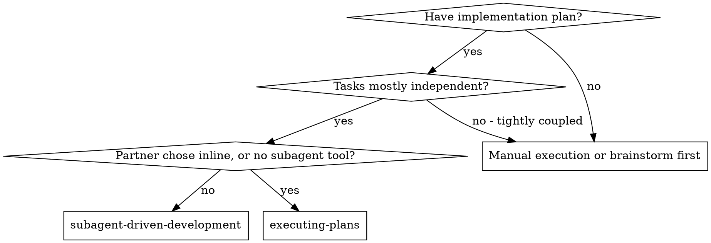
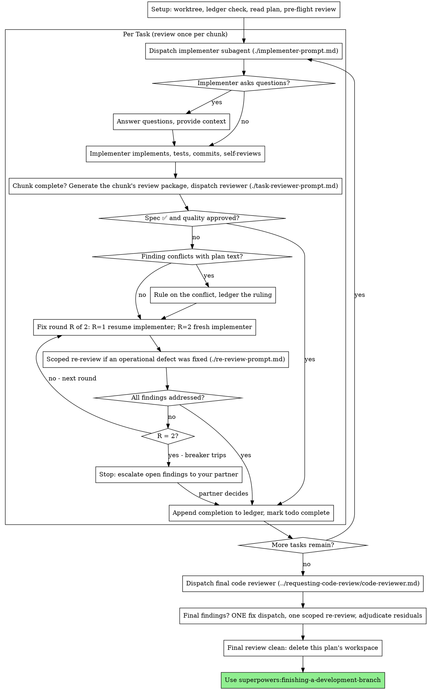

# Subagent-Driven Development

Execute plan by dispatching a fresh implementer subagent per task (one for a short run of small related tasks), one review (spec compliance + code quality) per risky chunk of related tasks, and a broad whole-branch review at the end. Every agent you dispatch costs tokens on every call it makes; see Token Budget.

**Why subagents:** You delegate tasks to specialized agents with isolated context. By precisely crafting their instructions and context, you ensure they stay focused and succeed at their task. They should never inherit your session's context or history — you construct exactly what they need. This also preserves your own context for coordination work.

**Core principle:** Fresh subagent per task + one review per risky chunk (spec + quality) + broad final review = high quality, fast iteration, at a token cost you keep small (Token Budget)

**Narration:** between tool calls, narrate at most one short line — the
ledger and the tool results carry the record.

**Continuous execution:** Do not pause to check in with your human partner between tasks. Execute all tasks from the plan without stopping. The only reasons to stop are the six named below, or all tasks complete. "Should I continue?" prompts and progress summaries waste their time — they asked you to execute the plan, so execute it.

**Rulings, not stalls.** A running plan does not wait on a human. Conflicts,
ambiguities, plan defects, a cap you would have asked to exceed — decide
them. The spec is the binding authority, the plan is its argument, and your
judgment settles what neither answers. Record every decision in the ledger as
`Ruling: <what you decided> — <why> — <what it costs if wrong>`, and keep
going. A wrong ruling costs rework your human partner can see and undo; a
session parked on a question costs their whole day and buys nothing.

Six things stop you, and only these: an irreversible or destructive
operation; a security-sensitive action; a side effect outside this worktree
that norms say you ask about first (a merge into the base branch, a push to a
shared branch, a publish); a plan so broken that every path forward is a
guess; a review fix loop with findings still open after round 2; and a step
or agent that still fails after one retry (using-superpowers, Subagents and
Stop Points). For those, stop and ask. Pushing the feature branch and opening its
PR/MR at the end is not one of them: finishing-a-development-branch does that
by default, and the PR/MR is where your human partner approves the merge.

## When to Use



**vs. Executing Plans (inline):**
- Fresh subagent per task (no context pollution) instead of one context doing every task
- One review per risky chunk of tasks (spec compliance + code quality) instead of only at the end
- Costs a fresh context per task and per review; inline costs one context plus one final reviewer
- Both run in this session, share the same plan workspace and ledger, and never pause between tasks

## The Process



## Setup

Ensure the work happens in an isolated workspace: use
superpowers:using-git-worktrees to create one or verify the existing one.
Never start implementation on a main/master branch without your human
partner's explicit consent.

**`.ai/` project policy.** Ensure the repo root has a `.ai/` folder defining
the project's policy (context, architecture, conventions, status). If it is
missing, create it before Task 1. Tell each implementer subagent to keep the
relevant `.ai/` files current in the same commit as the code change.

Conversation memory does not survive compaction. In real sessions,
controllers that lost their place have re-dispatched entire completed task
sequences — the single most expensive failure observed. Track progress in
a ledger file, not only in todos.

- Each plan owns a workspace: at skill start, run this skill's
  `bash scripts/sdd-workspace PLAN_FILE` — it prints the plan's git-ignored
  directory (under `<repo-root>/.superpowers/sdd/`), home to
  every artifact for THIS plan: ledger, briefs, reports, review packages.
  Another plan's directory is never yours to read or write.
- Check for this plan's ledger at `<workspace>/progress.md`. If its first
  line names your plan file, tasks with a `Task <N>: complete` line are DONE
  — do not re-dispatch them; resume at the first task without one. A task
  whose last line is a fix round is mid-loop: resume the loop at the next
  round. A ledger whose first line names a different plan file — or a stray
  ledger at the old flat path `.superpowers/sdd/progress.md` — is another
  plan's progress: leave it in place and start your own, fresh.
- Create the ledger with its identity as the first line:
  `# SDD ledger — plan: <plan file path>`.
- The ledger is your recovery map: the commits it names exist in git even
  when your context no longer remembers creating them. After compaction,
  trust the ledger and `git log` over your own recollection.
- `git clean -fdx` will destroy the workspace (it's git-ignored scratch); if
  that happens, recover from `git log`.
- **The ledger never travels; the status file does** (using-superpowers, Work
  Records). Each `Task <N>: complete` line and each `Ruling:` line also goes
  into `.ai/status/<slug>.md` (`## Done` / `## Decisions`, and `## Next` set to
  the following task), in the same commit as the work. With no ledger but a
  status file — another machine, a wiped workspace — rebuild the ledger from
  that file and `git log` and resume at `## Next`; it is not a fresh start.

Read the plan once, note its context and Global Constraints, and create a
todo per task. If the plan names a Spec, read that too: the spec is the
authority the plan argues from, and conflicts inside the plan resolve
against it. A plan with no reachable spec gets a ledger note saying so —
rulings made without one are provisional.

Before dispatching Task 1, scan the plan once for conflicts, writing down
what you checked as you check it:

- tasks that contradict each other or the plan's Global Constraints
- anything the plan explicitly mandates that the review rubric treats as a
  defect (a test that asserts nothing, verbatim duplication of a logic block)

The scan's output is a table, not a verdict. One row for every pair of tasks
that share a file or an interface: the two tasks, what one produces against
what the other consumes, and what you found. One row for every task: whether
its own text agrees with itself — the tests it specifies against the code it
specifies, the files it creates against the files it later touches. "The scan
is clean" without those rows is not a scan you ran.

Write the table to the ledger. Rule on everything you find before execution
begins — each finding against the plan text that mandates it — and record
each ruling in the ledger. If the scan is clean, proceed without comment.
Rule on each conflict it surfaces — the spec is the binding authority, the
plan is its argument — record the ruling beside its row, and dispatch
Task 1. The review loop remains the net for conflicts that only emerge from
implementation.

## Review Chunks

Review once per risky chunk, not once per task. Your human partner judged a
review after every task too frequent (fork policy, 2026-11-05): on a
well-specified plan, task after task came back Approved with only Minor
findings, and each review re-read the same surroundings at full cost.

Before Task 1, right after the pre-flight scan, group the plan's tasks into
review chunks and write the table to the ledger (`Chunk <X>: Tasks <a>-<b>,
<why these belong together>`). A chunk is consecutive tasks that build one
piece together:

- tasks that touch the same files or the same subsystem
- a tool and the task that first uses it
- several small tasks of the same shape (the same kind of edit repeated)

A task stands alone as its own chunk only when it is large or risky by
itself: new concurrency or timing logic, a security or data-loss surface, or
a diff you expect to exceed a few hundred lines. The last chunk may fold into
the final whole-branch review instead of getting its own review. Judge the
boundaries yourself and do not ask; record each chunk's reason in the
ledger.

**Keep reviews and test runs minimal (fork policy, 2026-11-10).** Your
human partner said "리뷰, 테스트는 항상 최소한으로 진행해" (always keep
reviews and test runs to the minimum). The tests the plan writes and the
frozen DoD's criteria already gate every task (RED, GREEN, Gate 2), so a
review earns its cost only where those tests cannot see the risk:

- Give a chunk its own review only when it carries a risk the tests do not
  pin: a new screen or input flow a person can get stuck in, a save or
  data format change, timing or concurrency logic, a security or data-loss
  surface, money. Fold a low-risk chunk (deletions, placing assets, plan
  code transcribed verbatim) into the review of the risky chunk next to
  it, preferably the one that consumes its output. A plan with no risky
  chunk gets no chunk review at all: the final whole-branch review is its
  one review (fork policy, 2026-11-15, Token Budget). Six natural chunks
  usually end as one or two chunk reviews plus the final one.
- A chunk that only changes docs, status files, or capture and tooling
  scripts gets no review; its acceptance criteria, capture comparison, or
  the Gate 2 verdict is its check. Ledger that as a ruling.
- Implementers run only the tests their brief names. The full suite runs
  at the end of each reviewed chunk and once before finishing, never once
  per task.
- Run that full suite yourself in the same turn you dispatch the chunk's
  reviewer (fork policy, 2026-11-14). The reviewer only reads, so neither
  waits for the other; an implementer told to run the suite holds the
  whole loop for as long as the suite takes. This is one heavy job beside
  one reader, which Token Budget allows: start no second heavy job
  (build, measurement, window capture) beside it. When the reviewer runs
  in the background, run the suite in the foreground with a timeout;
  otherwise run it in the background and wait for its completion
  notification, never checking on it in a loop. Dispatch
  no implementer into that working tree until the suite reports: its
  edits would change what the suite measures. A suite failure joins the
  review's findings in the same fix round. The run before finishing goes
  alongside the final whole-branch review the same way.
- Never shrink the tests themselves. The tests the plan writes and the
  frozen DoD's criteria are the contract; removing one is a Change Request
  your human partner approves.

Inside a chunk, every task still gets its own brief, its own tests, its
own commit, and its own ledger line, and its own implementer unless it
shares one with its small neighbors (The Task Loop, "One implementer for
a run of small tasks"). Only the review waits: when the chunk's last task reports DONE, generate one review package
from the chunk's start (the BASE you recorded before its first task) to
HEAD, and dispatch one reviewer with every brief and every report in the
chunk. The fix loop, its two rounds, and the completion lines below then
apply to the chunk as a whole. If an implementer inside a chunk reports
DONE_WITH_CONCERNS about correctness, or BLOCKED, deal with it before the
next task, exactly as for any task. When the chunk review comes back
clean, write a completion line for each task in the chunk.

Wherever the steps below say "task review", read "chunk review".

## Model Selection

**Do not pass a `model` argument** (using-superpowers, Subagents and Stop
Points): the dispatched agent's definition decides. The guidance below is for
writing those definitions, and for the dispatches where your partner asks
you to choose.

Use the least powerful model that can handle each role to conserve cost and increase speed.

**Mechanical implementation tasks** (isolated functions, clear specs, 1-2 files): use a fast, cheap model. Most implementation tasks are mechanical when the plan is well-specified.

**Integration and judgment tasks** (multi-file coordination, pattern matching, debugging): use a standard model.

**Architecture and design tasks**: use the most capable available model.
The final whole-branch review is one of these — dispatch it on the most
capable available model, not the session default.

**Review tasks**: choose the model with the same judgment, scaled to the
diff's size, complexity, and risk. A small mechanical diff does not need the
most capable model; a subtle concurrency change does. Scoped re-reviews of
small fix diffs take a cheap-to-mid tier.

**Fix-loop round 2**: a fresh implementer; one tier above the one that got
stuck only when a project agent definition offers it or your partner names it.

**An omitted model follows the agent definition.** A `general-purpose`
dispatch inherits your session's model; when that cost matters, the fix is an
agent definition with its own `model:`, not a per-call override.

**Turn count beats token price.** Wall-clock and context cost scale with how
many turns a subagent takes, and the cheapest models routinely take 2-3× the
turns on multi-step work — costing more overall. Use a mid-tier model as the
floor for reviewers and for implementers working from prose descriptions.
When the task's plan text contains the complete code to write, the
implementation is transcription plus testing: use the cheapest tier for
that implementer. Single-file mechanical fixes also take the cheapest tier.

**Task complexity signals (implementation tasks):**
- Touches 1-2 files with a complete spec → cheap model
- Touches multiple files with integration concerns → standard model
- Requires design judgment or broad codebase understanding → most capable model

## Token Budget (fork policy, 2026-11-15)

Your human partner said "토큰도 너무 잡아 먹는거 같음. 특히 서브에이전트들
때문에" (this eats too many tokens, above all because of the subagents).
An agent re-reads its whole context on every tool call, so its cost is
roughly (number of calls) x (average context). A long-lived agent grows
both, so its cost grows with the square of its lifetime. Measured in one
real session: one implementer given three tasks made 329 tool calls and
read about 107M cached tokens, about 320k of context per call, because
every screenshot it opened stayed in its context; that one agent was
about half of what all ten of the session's subagents cost together. A
verifier waiting on a background test checked its status 108 times.
Three agents ran heavy jobs side by side (full suite, GPU frame timing,
window captures): six processes overlapped, the timing failed falsely,
and it had to be measured again.

These rules bind you and go into every dispatch (the templates carry the
ones a subagent keeps):

- **Lifetime.** One fresh agent per task is the default, and it ends at
  its commit: never hand a finished implementer its next task. Several
  small tasks share one implementer only under the caps in The Task Loop.
- **Narrow brief.** A dispatch carries the task brief, the files to
  change, and the acceptance criteria. Never make an agent read the whole
  plan or a whole design document: copy the section the task needs into
  the dispatch, or name it by heading.
- **Waiting on a command.** Run a long command (suite, build, export) in
  the foreground with a timeout long enough for it to finish, and take
  its result once. Never start it in the background and check its status
  in a loop: every check is a call that re-reads the whole context. When
  it must run in the background, wait for its completion notification
  and nothing else.
- **Images.** An image an agent opens stays in its context and is re-read
  on every later call. Open only the few a verdict needs. When many must
  be looked at, dispatch a short-lived agent that only looks at those
  images and returns one verdict line per image, or hand them to your
  partner.
- **Heavy jobs one at a time.** A full suite, a build, a GPU or frame-time
  measurement, and a capture that opens a window run one at a time across
  all agents, yours included: overlapping them slows each one and makes
  measurements fail falsely. What runs side by side is light: reading,
  writing code and docs, selected tests. The full suite beside a reading
  reviewer (Review Chunks) is one heavy job and one light one, which this
  allows. Running agents side by side saves time, never tokens.
- **Review by risk.** One review at the end of the plan is the default; a
  chunk gets its own review only for the risks Review Chunks names. A
  re-review runs only for an operational defect (The fix loop).
- **The controller's share.** A merge, one status-file line, a check that
  takes a few calls: do it yourself instead of dispatching. A dispatched
  agent pays its start-up reading before its first useful call. Fixing
  review findings is not in this share (The fix loop).

## The Task Loop

**Batch small same-shape work.** When the plan lists several tasks that are
each a small, independent edit of the same kind — the same one-line fix,
constant change, or field addition repeated across files — do not dispatch
one subagent per task. Compose ONE dispatch brief listing every file and
its change, send the whole batch to a single subagent, and review its diff
as one unit. Reserve one-dispatch-per-task for work that needs its own
judgment, its own tests, or its own review surface. A batch stays under
the same caps as a run of small tasks (below).

**One implementer for a run of small tasks (fork policy, 2026-11-14).**
Your human partner said "task마다 그렇게 오래 걸릴 작업은 아닌 것 같은데"
(no single task is big enough to take that long). A fresh implementer
reads the same instructions, project rules and surrounding code before it
writes a line, so a small task dispatched alone is mostly start-up. When
consecutive tasks are each small and edit the same files or the same
subsystem, dispatch ONE implementer for the run, under two caps (fork
policy, 2026-11-15, Token Budget): the run together is expected to take a
few dozen tool calls at most, and no task in it opens images (captures,
screenshots, rendered output). Past either cap the shared context grows
on every call and soon costs more than the start-up it saved; give each
task its own fresh implementer instead. Within the caps:

- name every task's brief, in order, and state the decisions from earlier
  tasks once
- each task keeps its own tests, its own commit, and its own section in
  one report file; write one ledger line per task from that report
- the implementer stops at the first task it cannot finish, leaves the
  earlier commits in place, and reports what it left uncommitted

A task that is large or risky by itself (one that would stand alone as a
review chunk) keeps its own implementer, and so does a task that shares
neither a file nor a subsystem with the tasks next to it. A run stays
inside one review chunk. Decide the runs when you write the review
chunks, and record them in the ledger.

Everything you paste into a dispatch prompt — and everything a subagent
prints back — stays resident in your context for the rest of the session
and is re-read on every later turn. Hand artifacts over as files.

**Waiting on dispatched subagents:** never poll a wait interface with
short timeouts, and never sit in one silent, open-ended wait either.
While you have local work — ledger updates, packaging the next review,
reading reports — keep working; child results arrive on their own.
When you are genuinely idle, wait in bounded stretches (five to ten
minutes, where your platform allows), and between stretches post one
line of status and reconcile your live children: list them, and chase
any that finished without reporting. A bounded stretch keeps nearly
all of a long wait's efficiency while guaranteeing a stuck or lost
child is noticed within minutes, not at the end of the session.

### 1. Dispatch the implementer

Record BASE (`git rev-parse HEAD`) before dispatching — the review package
and fix-round diffs need it.

- **Task brief:** before dispatching an implementer, run this skill's
  `bash scripts/task-brief PLAN_FILE N` — it extracts the task's full text to a
  uniquely named file and prints the path. Compose the dispatch so the
  brief stays the single source of
  requirements. Your dispatch should contain: (1) one line on where this
  task fits in the project; (2) the brief path, introduced as "read this
  first — it is your requirements, with the exact values to use verbatim";
  (3) interfaces and decisions from earlier tasks that the brief cannot
  know; (4) your resolution of any ambiguity you noticed in the brief;
  (5) the report-file path and report contract. Exact values (numbers,
  magic strings, signatures, test cases) appear only in the brief. Never
  make a subagent read the whole plan file or a whole design document;
  name the files to change and the section it needs (Token Budget).
- **Report file:** name the implementer's report file after the brief
  (brief `…/task-N-brief.md` → report `…/task-N-report.md`) and put it in
  the dispatch prompt. The implementer writes the full report there and
  returns only status, commits, a one-line test summary, and concerns.
- A dispatch prompt describes one task, not the session's history. Do not
  paste accumulated prior-task summaries ("state after Tasks 1-3") into
  later dispatches — a real session's dispatch hit 42k chars of which 99%
  was pasted history. A fresh subagent needs its task, the interfaces it
  touches, and the global constraints. Nothing else.
- The dispatch carries the no-subagents contract (it is in the
  implementer template): the implementer never dispatches subagents —
  not helpers, and never a reviewer. Review arrives from you, after the
  report. In real sessions, every reviewer a worker spawned duplicated
  the task review the controller dispatched anyway — a full extra
  review seat per task.
- If an earlier task parked a finding in the area this task touches, carry
  a pointer to that ledger entry in the dispatch.
- Record the implementer's agent identity from the dispatch result: fix
  round 1 may resume this agent. Otherwise it ends at its commit; the
  next task gets a fresh implementer unless it is in the same run.
- Never dispatch multiple implementation subagents in parallel (conflicts).

Template: [implementer-prompt.md](implementer-prompt.md)

### 2. Handle the report

Implementer subagents report one of four statuses. Handle each appropriately:

**DONE:** Generate the review package (`bash scripts/review-package PLAN_FILE BASE HEAD`, from this skill's directory; it prints the unique file path it wrote. BASE is the commit you recorded before dispatching the implementer, never `HEAD~1`, which silently drops all but the last commit of a multi-commit task), then dispatch the task reviewer with the printed path and, in the same turn, run the full suite (see Review Chunks). Do this only when the task closes its chunk; otherwise record the task's commits in the ledger and dispatch the next task in the chunk.

**DONE_WITH_CONCERNS:** The implementer completed the work but flagged doubts. Read the concerns before proceeding. If the concerns are about correctness or scope, address them before review. If they're observations (e.g., "this file is getting large"), note them and proceed to review.

**NEEDS_CONTEXT:** The implementer needs information that wasn't provided. Provide the missing context and re-dispatch.

**BLOCKED:** The implementer cannot complete the task. Assess the blocker:
1. If it's a context problem, provide more context and re-dispatch the same agent
2. If the task requires more reasoning, re-dispatch a more capable agent definition if the project has one; otherwise report to your partner, who may name a model
3. If the task is too large, break it into smaller pieces
4. If the plan itself is wrong, rule on the correction, ledger it, and re-dispatch with the ruling carried in the dispatch

That is one retry. If the re-dispatch is BLOCKED again, stop and report to your partner with what was tried — never skip the task. **Never** ignore an escalation or retry without changes. If the implementer said it's stuck, something needs to change.

If the implementer asks questions — before starting or mid-task — answer
clearly and completely, provide additional context if needed, and don't
rush it into implementation.

### 3. Review the task

Per-task reviews are task-scoped gates. The broad review happens once, at the
final whole-branch review. Never skip a review the chunk table schedules, and never accept a
report missing either verdict — spec compliance AND task quality are both
required. Implementer self-review never replaces the task review; both are
needed.

- Hand the reviewer its diff as a file: run this skill's
  `bash scripts/review-package PLAN_FILE BASE HEAD` and pass the reviewer the file path
  it prints (or, without bash: `git log --oneline`, `git diff --stat`,
  and `git diff -U10` for the range, redirected to one uniquely named
  file). The output never enters your own context, and the reviewer sees
  the commit list, stat summary, and full diff with context in one Read
  call. Use the BASE you recorded before dispatching the implementer —
  never `HEAD~1`, which silently truncates multi-commit tasks. Never
  dispatch a task reviewer without a diff file.
- **Reviewer inputs:** the task reviewer gets three paths — the same brief
  file, the report file, and the review package — plus the global
  constraints that bind the task.
- The global-constraints block you hand the reviewer is its attention
  lens. Copy the binding requirements verbatim from the plan's Global
  Constraints section or the spec: exact values, exact formats, and the
  stated relationships between components ("same layout as X", "matches
  Y"). The reviewer's template already carries the process rules (YAGNI,
  test hygiene, review method) — the constraints block is for what THIS
  project's spec demands.
- Do not add open-ended directives like "check all uses" or "run race tests
  if useful" without a concrete, task-specific reason
- Do not ask a reviewer to re-run tests the implementer already ran on the
  same code — the implementer's report carries the test evidence
- Do not pre-judge findings for the reviewer — never instruct a reviewer to
  ignore or not flag a specific issue. If you believe a finding would be a
  false positive, let the reviewer raise it and adjudicate it in the review
  loop. If the prompt you are writing contains "do not flag," "don't treat X
  as a defect," "at most Minor," or "the plan chose" — stop: you are
  pre-judging, usually to spare yourself a review loop.
The task reviewer may report "⚠️ Cannot verify from diff" items — requirements
that live in unchanged code or span tasks. These do not block the rest of the
review, but you must resolve each one yourself before marking the task
complete: you hold the plan and cross-task context the reviewer
lacks. If you confirm an item is a real gap, treat it as a failed spec
review — it enters the fix loop with the other findings.

Template: [task-reviewer-prompt.md](task-reviewer-prompt.md)

### 4. The fix loop

The loop triggers when the review reports spec ❌, any Critical or Important
finding, or a ⚠️ item you confirmed as a real gap.

Before the loop starts, two routes leave it immediately:

- Record Minor findings in the progress ledger as you go
  (`Task <N>: minor (deferred): <one-liner>`), and point the final
  whole-branch review at that list so it can triage which must be fixed
  before merge. A roll-up nobody reads is a silent discard. Minor findings
  never enter the loop.
- A finding labeled plan-mandated — or any finding that conflicts with
  what the plan's text requires — is yours to rule on: weigh the finding
  against the plan text, decide with the spec as the binding authority, and
  ledger the ruling before you act on it. Do not dismiss the finding because
  the plan mandates it, and do not dispatch a fix that contradicts the plan
  without a recorded ruling.
Everything else enters the loop. A fix round is one fix dispatch plus, when
the round fixes an operational defect, one scoped re-review (fork policy,
2026-11-15, Token Budget). An operational defect is a finding whose way of
reaching users or operations you can write in one line; ledger that line
with it. A finding you cannot write that line for is a check defect (a
test, wording, structure): its fix is checked by the covering tests in the
fix report and by the final whole-branch review, not by a re-review. Two
rounds maximum per chunk, and round 2 runs only when the re-review leaves
a finding open (using-superpowers, Subagents and Stop Points). When the
project sets its own cap or counting rule for review chains, apply it as
well; the loop stops at whichever cap comes first.

**Round 1: resume the original implementer** when its context stayed
small (within the run caps in The Task Loop: a few dozen calls, no
images). Send it the open findings verbatim. Its context is intact: it
knows the task, the code, and its own choices. If your harness cannot send
another message to a live subagent, or the implementer grew past those
caps, dispatch a fresh implementer carrying the brief path, the
report-file path, and the findings; the report file is the persistent
memory either way.

**Round 2: dispatch a fresh implementer** (the same agent definition; a
more capable one only when the project has it or your partner names a
model), with the brief path, the report-file path, the open findings, and
this framing: "A prior implementer attempted this task once; you own it
now. Read the report file for what was tried." A finding that survives a
resume usually means the implementer cannot see its own problem — fresh
eyes are the remaining move.

**Every round, either way:** the implementer fixes, re-runs the tests
covering the amended code, appends its fix report to the same report file,
and returns the short contract. Confirm the fix report contains the
covering tests, the command run, and the output; when the round gets a
re-review, dispatch it once all three are present. Name the
covering test files in the fix message — a one-line fix does not need the
whole suite.

**The re-review is scoped.** Run `bash scripts/review-package PLAN_FILE FIX_BASE HEAD`
where FIX_BASE is the head the previous review saw, and dispatch
[re-review-prompt.md](re-review-prompt.md) with the findings list, the
brief, the report file, and the printed diff path. The re-reviewer verdicts
each finding ADDRESSED or NOT ADDRESSED and flags new breakage in the fix
diff only. New Critical/Important breakage in the fix diff joins the open
findings list. Out-of-scope observations go to the ledger as deferred
minors — they never extend the loop.

**After each round,** append to the ledger:
`Task <N>: fix round <R>/2 (<X> addressed, <Y> open — <finding one-liners>; commits <a7>..<b7>)`

Never fix findings yourself in the controller session — your context stays
clean for coordination, and controller fixes skip review. Bookkeeping and
checks of a few calls are yours (Token Budget); code fixes are not.

**The breaker.** When round 2's re-review still leaves findings open, stop
dispatching and escalate to your partner — do not adjudicate them yourself.
Give each open finding with what both rounds tried, your read of it (reviewer
wrong or contestable / real but nothing builds on it / real and
load-bearing), the options and your recommendation. Ledger it as
`Task <N>: escalated — <finding one-liners>`, put it in the status file's
`## Open` and `## Next`, and carry out what your partner decides; each of
their decisions is a ledger `Ruling:` line.

Escalate only at the cap. Ending a loop early by dismissing a finding is
pre-judging with a different name. Every decision is a ledger entry —
a silent discard is forbidden.

### 5. Complete the task

When the review comes back clean — or every open finding is parked with a
ruling at the cap — append the completion line to the ledger in the same
message as your other bookkeeping:

- `Task <N>: complete (commits <base7>..<head7>, review clean)`
- `Task <N>: complete (commits <base7>..<head7>, <K> parked)` after a
  tripped breaker

Then mark the todo complete and move on. Never move to the next task while
the review has open Critical/Important issues that are neither fixed nor
parked-with-ruling at the cap.

## Final Review

The final whole-branch review gets a package too: run
`bash scripts/review-package PLAN_FILE MERGE_BASE HEAD` (MERGE_BASE = the commit the
branch started from, e.g. `git merge-base main HEAD`) and include the
printed path in the final review dispatch, so the final reviewer reads
one file instead of re-deriving the branch diff with git commands. Dispatch
the project's code-review agent if it has one (see Model Selection: no
`model` argument), using
superpowers:requesting-code-review's
[code-reviewer.md](../requesting-code-review/code-reviewer.md). Point it at
the ledger's deferred-minor and parked lines so it can triage which must be
fixed before merge. If the branch has a contract to keep, dispatch
[contract-reviewer.md](../requesting-code-review/contract-reviewer.md) in
parallel with it and settle disagreements by superpowers:requesting-code-review's
"Two Seats" rules; its findings join the same single fix wave.

If the final whole-branch review returns findings, dispatch ONE fix subagent
with the complete findings list — not one fixer per finding.
Per-finding fixers each rebuild context and re-run suites; a real
session's final-review fix wave cost more than all its tasks combined.
Then, when the findings include an operational defect (The fix loop), run
exactly one scoped re-review of the fix wave
(`bash scripts/review-package PLAN_FILE FIX_BASE HEAD` over the fix range,
[re-review-prompt.md](re-review-prompt.md)); a wave of check defects only
is checked by its covering tests and the suite run before finishing.
Adjudicate any residual findings as in the task loop's breaker: park with
rulings, or rule on the load-bearing ones and ledger what you decided. Only
the four classes above stop you here. There is no second fix wave —
residual load-bearing findings surface to your human partner in the PR/MR
body and your final report when finishing-a-development-branch opens the PR/MR.

## Finish

Before you delete anything, collect every ledger line containing `Ruling:` —
preflight rulings, parked findings, breaker adjudications, all of them — into
your final message under "Rulings I made", in the order you made them, each
with what it costs if wrong. The list is exhaustive: if the ledger holds a
ruling, the list holds it. That list is the only place the decisions you
took on your human partner's behalf reach them — they read it and rework
whatever you got wrong. A ruling that dies with the workspace was a decision
made in secret.

When the final whole-branch review is clean and its fixes are merged,
delete this plan's workspace (`rm -rf <workspace>`) — the git history is
the record now. Sibling directories belong to other plans; leave them
alone.

**If `docs/work/<slug>/dod.md` is FROZEN, print its Gate 2 verdict first** (REQUIRED
SUB-SKILL: superpowers:definition-of-done), run against the branch head. `AWAITING_HUMAN`
or `FAILED` is reported as such — never as "done".

Use superpowers:finishing-a-development-branch.

## Common Rationalizations

| Excuse | Reality |
|--------|---------|
| "Close enough on spec compliance" | Reviewer found spec gaps = not done. Fix, or hit the cap and escalate — those are the only exits. |
| "I'll fix it myself, dispatching is overhead" | Controller fixes pollute your context and skip review. Resume the implementer. |
| "One more round will converge" | Past the cap, rounds don't converge — the failure is structural. Escalate to your partner. |
| "The reviewer will just find something new anyway" | Scoped re-reviews verify fixes; they cannot wander. New findings on untouched code go to the ledger, not the loop. |
| "This finding is obviously wrong, I'll drop it" | At the cap your partner decides, and every decision is a ledger entry. Silent discards are forbidden. |
| "The fix was small, skip the re-review" | Size is not the test. A round that fixes an operational defect ends with a scoped re-review, however small the fix; a round of check defects only is checked by its covering tests. |
| "Re-review everything, to be safe" | A re-review re-reads the diff at full cost. If you cannot write in one line how the finding reaches users or operations, it is a check defect and its covering tests are the check. |
| "Reviews slow the loop down" | The loop without reviews is just unverified churn. Reviews are the loop's brakes and steering. |
| "Ledger bookkeeping is overhead" | The ledger is what survives compaction. Controllers without one have re-dispatched entire completed task sequences. |
| "The implementer spawned its own reviewer — free extra assurance" | It's a duplicate seat reviewing the same diff; the task review is the gate. A worker-spawned reviewer is a defect to flag, not rigor. |
| "Every task deserves its own fresh implementer" | A small task dispatched alone is mostly start-up reading. A short run of small tasks on the same files shares one implementer; each task keeps its own tests and commit. |
| "This implementer already knows the code, give it the next task too" | Its every later call re-reads everything it has seen. Past a few dozen calls, or once it has opened images, a fresh implementer is cheaper than its start-up. |
| "The chunk's last implementer can run the full suite" | That holds the loop for the suite's whole duration. Run it yourself while the reviewer reads. |
| "I'll start it in the background and check on it" | Every check re-reads the whole context; one verifier checked 108 times. Foreground with a timeout, or wait for the completion notification. |
| "Let me look at all the captures myself" | Each image stays in context for every later call. Open the few a verdict needs; give the rest to a short image-only agent or to your partner. |
| "Run the suite, the build and the captures in parallel to save time" | Heavy jobs run one at a time. Overlapped, they slow each other and the measurements fail falsely; parallel agents save time, never tokens. |
| "I'll update `.ai/` later, in one pass" | A commit touching routes, data model, conventions, or progress without its `.ai/` update is incomplete. Same commit, every time. |

## Example Workflow

```
You: I'm using Subagent-Driven Development to execute this plan.

[Setup: worktree verified]
[Read plan file once: docs/superpowers/plans/feature-plan.md]
[Resolve workspace: bash scripts/sdd-workspace docs/superpowers/plans/feature-plan.md — no ledger inside, fresh start]
[Create todos for all tasks]

Task 1: Hook installation script

[Run task-brief for Task 1; dispatch implementer with brief + report paths + context]

Implementer: "Before I begin - should the hook be installed at user or system level?"

You: "User level (~/.config/superpowers/hooks/)"

Implementer: [Later]
  - Implemented install-hook command
  - Added tests, 5/5 passing
  - Self-review: Found I missed --force flag, added it
  - Committed

[Run review-package PLAN_FILE BASE HEAD; dispatch task reviewer with the printed path]
Task reviewer: Spec ✅ - all requirements met, nothing extra.
  Strengths: Good test coverage, clean. Issues: None. Task quality: Approved.

[Ledger: Task 1: complete (commits a1b2c3d..d4e5f6a, review clean)]

Task 2: Recovery modes

[Run task-brief for Task 2; dispatch implementer with brief + report paths + context]

Implementer: [No questions]
  - Added verify/repair modes
  - 8/8 tests passing
  - Committed

[Run review-package PLAN_FILE BASE HEAD; dispatch task reviewer with the printed path]
Task reviewer: Spec ❌:
  - Missing: Progress reporting (spec says "report every 100 items")
  Issues (Important): Magic number (100)

[Fix round 1: resume the implementer with both findings]
Implementer: Added progress reporting, extracted PROGRESS_INTERVAL constant.
  Re-ran test/recovery.test.js — 10/10 passing. Fix report appended.

[Run review-package PLAN_FILE FIX_BASE HEAD; dispatch scoped re-review]
Re-reviewer: Missing progress reporting — ADDRESSED (src/recovery.js:41).
  Magic number — ADDRESSED (src/recovery.js:7). New breakage: none.
  Verdict: all findings addressed.

[Ledger: Task 2: fix round 1/2 (2 addressed, 0 open; commits d4e5f6a..b7c8d9e)]
[Ledger: Task 2: complete (commits d4e5f6a..b7c8d9e, review clean)]

...

[After all tasks]
[Run review-package PLAN_FILE MERGE_BASE HEAD; dispatch final code-reviewer (project agent, its own model)]
Final reviewer: All requirements met. Deferred minors triaged: none block merge.

[Delete this plan's workspace — the record now lives in git]

Done! Using superpowers:finishing-a-development-branch.
```
